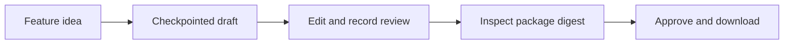

# SpecBridge

SpecBridge turns a feature idea and selected evidence into a persisted PRD and linked stories, human review, and an independently runnable documentation package.

**The technical first slice is implemented.** Local fixture/browser and standalone-package checks exercise the workflow. Full Milestone 1 acceptance remains open: a live compatible provider, semantic output quality, and an unfamiliar-human handoff have not been validated. See [verification results and limitations](docs/evaluations/first-slice-results.md).



## Run locally

Use Python 3.12, Node 22.23.1, npm 10 and uv (CI pins uv 0.12.17). From the repository root:

```sh
uv sync --locked
npm --prefix apps/web ci --ignore-scripts
SPECBRIDGE_PROVIDER=fixture PYTHONPATH=services/api uv run python -m specbridge
```

In a second terminal, from the same root:

```sh
npm --prefix apps/web run dev
```

Open `http://127.0.0.1:5173`. On initial startup the API creates an owner-only `.data/session-token`. Copy its contents privately into the UI's **Session token** password field and connect. Never paste the token into chat, URLs, logs or committed files. The browser keeps it only in tab memory; refresh requires entering it again. SQLite project data lives in `.data/specbridge.db`; protect and back up that directory rather than deleting it to reset a session.

Create or choose a project, enter a feature idea, acknowledge the displayed generation destination, and generate a draft. Inspect original source evidence, findings and structured fields. Save edits as a new revision, record review notes, prepare the package, inspect its manifest, approve that exact digest, and download. Reopen a saved run after refresh; completed generation stages are retained. A failed or interrupted provider stage requires an explicit potentially billable retry acknowledgment.

The default **DEMO fixture provider** emits generic deterministic examples. It does not understand arbitrary feature requests or validate business facts. The compatible provider is opt-in through environment variables in the API process: `SPECBRIDGE_PROVIDER=compatible`, `SPECBRIDGE_LLM_BASE_URL`, `SPECBRIDGE_LLM_MODEL`, and `SPECBRIDGE_LLM_API_KEY`. See [.env.example](.env.example); the launcher does not automatically load that file. Keep credentials in local process configuration. Compatible-provider transport/schema behavior has mock coverage only; no paid/live model call is established by fixture checks.

For one-process static serving, build the UI, then restart the API with its matching origin:

```sh
npm --prefix apps/web run build
SPECBRIDGE_PROVIDER=fixture SPECBRIDGE_UI_ORIGIN=http://127.0.0.1:8000 PYTHONPATH=services/api uv run python -m specbridge
```

Open `http://127.0.0.1:8000`. Both modes bind to loopback; this is a single-operator local application, not a multi-user deployment.

## Verify and explore

```sh
python3 -m unittest discover -s tests -v
uv run pytest -q
npm --prefix apps/web run typecheck
npm --prefix apps/web run lint
npm --prefix apps/web test
npm --prefix apps/web run build
npm ci
npm exec playwright install chromium
npm run test:e2e
uv run python scripts/verify_handoff.py --output /tmp/specbridge-handoff-check
```

Stop manual servers before browser tests; tests own ports 8000/5173 and isolated temporary data. Use a fresh, nonexistent output directory for each standalone handoff run. That runner installs, builds and browses the extracted Starlight project with SpecBridge stopped. Registry access is needed for installs. See [the implementation plan](docs/plans/2026-10-15-first-slice-implementation.md) for the remaining static, contract and dependency-audit commands, and [the template README](packages/docs-template/README.md) for independent documentation commands and the known moderate build-time dependency advisory.

The [architecture](docs/architecture/first-slice.md), [accepted ADR](docs/decisions/0001-local-modular-monolith.md), [security boundaries](docs/security/threat-model.md), [roadmap](docs/plans/bootstrap-and-first-slice.md) and [skill inventory](docs/engineering/skill-inventory.md) explain current boundaries. The [bootstrap report](docs/engineering/bootstrap-report.md), [environment audit](docs/engineering/environment-audit.md) and [reference research](docs/engineering/reference-research.md) remain historical evidence.

No remote publication or external integration is configured. Original SpecBridge code has no distribution license selected; reference repository licenses do not license this project.
