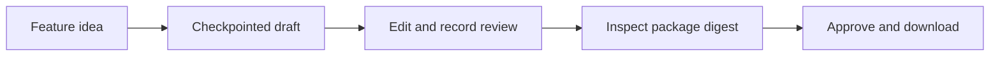

# SpecBridge

SpecBridge turns a feature idea and selected evidence into a persisted PRD and linked stories, human review, and an independently runnable documentation package.

**The technical first slice is implemented.** Local fixture/browser and standalone-package checks exercise the workflow, and live compatible-provider transport has been exercised. Full Milestone 1 acceptance remains open: semantic output quality and an unfamiliar-human handoff have not passed. See [current phase status](docs/plans/roadmap-status-2026-10-16.md) for current evidence and limitations.



## Run locally

Use Python 3.12, Node 22.23.1, npm 10 and uv (CI pins uv 0.12.17). From the repository root:

```sh
uv sync --locked
npm --prefix apps/web ci --ignore-scripts
SPECBRIDGE_PROVIDER=fixture PYTHONPATH=services/api uv run python -m specbridge
```

In a second terminal, from the same root:

```sh
npm --prefix apps/web run dev
```

Open `http://127.0.0.1:5173`. On initial startup the API creates an owner-only `.data/session-token`. Copy its contents privately into the UI's **Session token** password field and connect. Never paste the token into chat, URLs, logs or committed files. The browser keeps it only in tab memory; refresh requires entering it again. SQLite project data lives in `.data/specbridge.db`; protect and back up that directory rather than deleting it to reset a session.

Create or choose a project, enter a feature idea, acknowledge the displayed generation destination, and generate a draft. Inspect original source evidence, findings and structured fields. Save edits as a new revision, record review notes, prepare the package, inspect its manifest, approve that exact digest, and download. Reopen a saved run after refresh; completed generation stages are retained. A failed or interrupted provider stage requires an explicit potentially billable retry acknowledgment.

Handoff rules now require verbatim excerpts for `user_provided` claims, proposal labels for synthesized stories, and explicit story links covering every requirement. Unstated motivations are omitted and unknown constraints stay questions. Older snapshots remain readable; drafts that fail these rules need a corrected revision before publication. See [the active rules and verification limits](docs/evaluations/handoff-rules-results.md).

The [autonomous full-pack check](docs/evaluations/autopilot-qualification.md) did not meet semantic acceptance after three bounded rounds. Application regression checks pass; the model provider remains unqualified for automatic handoff. Experimental prompts were archived and the committed runtime skill restored. Subsequent [no-client-cap](docs/evaluations/no-client-cap-retest.md), [reasoning-low](docs/evaluations/reasoning-low-comparison.md) and [reasoning-high](docs/evaluations/reasoning-high-comparison.md) comparisons each passed only two semantic cases out of five. The [Pro model comparison](docs/evaluations/pro-model-comparison.md) produced one semantic pass, two semantic failures and two timeouts with no assessable draft. No configuration was promoted. See the [remaining phases](docs/plans/roadmap-status-2026-10-16.md).

The [expandable phase board](docs/engineering/specbridge-progress.html) is a reporting snapshot refreshed at verified checkpoints. If your chat client cannot render it, the current session's ordinary browser copy is at `exports/specbridge-progress.html`; it works offline and can be copied to another device. Generated exports are ignored by Git; the maintained roadmap is the portable text fallback. Neither the board nor its export performs background synchronization or grants acceptance.

The default **DEMO fixture provider** emits generic deterministic examples. It does not understand arbitrary feature requests or validate business facts. The compatible provider is opt-in through environment variables in the API process: `SPECBRIDGE_PROVIDER=compatible`, `SPECBRIDGE_LLM_BASE_URL`, `SPECBRIDGE_LLM_MODEL`, and `SPECBRIDGE_LLM_API_KEY`. See [.env.example](.env.example). Put your key in the ignored, private `.env` file and load it explicitly with `PYTHONPATH=services/api uv run --env-file .env python -m specbridge`. The launcher does not load environment files automatically. DeepSeek uses explicit `SPECBRIDGE_LLM_OUTPUT_MODE=json_object`; other endpoints default to `json_schema`. Both modes enforce the same backend Artifact/source validation. `SPECBRIDGE_LLM_MAX_TOKENS` sets a 1–16384 output-token cap (default 4096); this does not establish a dollar budget. DeepSeek is configured with `SPECBRIDGE_LLM_REASONING_EFFORT=none` for a bounded non-thinking trial; this optional field is omitted when unset and must be supported by the chosen endpoint/model. Truncated responses fail instead of silently retrying. An initial [live synthetic measurement](docs/evaluations/deepseek-complete-response.md) completed. A later [revised-rules live check](docs/evaluations/deepseek-handoff-rules-live.md) passed current validation and addressed the observed motivation/link errors on that case. The initial measurement’s 1469-token output informed the DeepSeek example cap of 3072 tokens; The [five-case unrelated-feature check](docs/evaluations/deepseek-out-of-sample.md) produced three valid drafts and two rejected conflict drafts. Both conflict cases passed a [targeted retest after the skill 1.2.0 correction](docs/evaluations/conflict-handoff-fix.md); broader semantic quality and larger-request limits remain unqualified. Keep credentials in local process configuration. Mock tests cover compatible-provider transport/schema failure paths; fixture checks alone do not establish live-provider behavior.

For longer reasoning requests, set `SPECBRIDGE_LLM_TIMEOUT_SECONDS=none` in private process configuration to disable generation total/read deadlines. A finite positive number sets a whole-request deadline; unset defaults to 60 seconds. Connection establishment remains bounded to at most 30 seconds, and response size remains bounded. The backend renews its owned workflow lease while generation runs, preventing a healthy long request from becoming eligible for duplicate execution. A stopped process stops renewal; recovery still requires explicit retry acknowledgement. If lease renewal fails, the returned result is discarded; an already stalled provider call can continue until it returns or the process is stopped. Unlimited waiting does not guarantee provider completion or semantic correctness. Restart a running API to load changed configuration. Evaluation previews bind the chosen wait policy as well as the request payload.

For one-process static serving, build the UI, then restart the API with its matching origin:

```sh
npm --prefix apps/web run build
SPECBRIDGE_PROVIDER=fixture SPECBRIDGE_UI_ORIGIN=http://127.0.0.1:8000 PYTHONPATH=services/api uv run python -m specbridge
```

Open `http://127.0.0.1:8000`. Both modes bind to loopback; this is a single-operator local application, not a multi-user deployment.

## Verify and explore

```sh
python3 -m unittest discover -s tests -v
uv run pytest -q
npm --prefix apps/web run typecheck
npm --prefix apps/web run lint
npm --prefix apps/web test
npm --prefix apps/web run build
npm ci
PLAYWRIGHT_BROWSERS_PATH=.cache/playwright npm exec playwright install chromium
npm run test:e2e
uv run python scripts/verify_handoff.py --output /tmp/specbridge-handoff-check
```

Stop manual servers before browser tests; tests own ports 8000/5173 and isolated temporary data. Use a fresh, nonexistent output directory for each standalone handoff run. That runner installs, builds and browses the extracted Starlight project with SpecBridge stopped. Registry access is needed for installs. See [the implementation plan](docs/plans/2026-10-15-first-slice-implementation.md) for the remaining static, contract and dependency-audit commands, and [the template README](packages/docs-template/README.md) for independent documentation commands and the reviewed parser security override.

The [architecture](docs/architecture/first-slice.md), [accepted ADR](docs/decisions/0001-local-modular-monolith.md), [security boundaries](docs/security/threat-model.md), [roadmap](docs/plans/bootstrap-and-first-slice.md) and [skill inventory](docs/engineering/skill-inventory.md) explain current boundaries. The [bootstrap report](docs/engineering/bootstrap-report.md), [environment audit](docs/engineering/environment-audit.md) and [reference research](docs/engineering/reference-research.md) remain historical evidence.

No remote publication or external integration is configured. Original SpecBridge code has no distribution license selected; reference repository licenses do not license this project.
