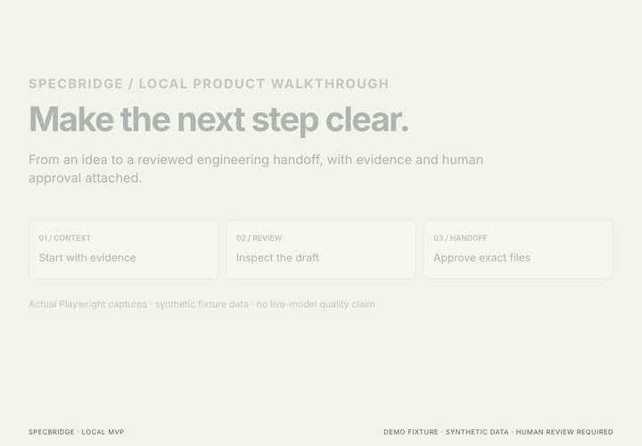
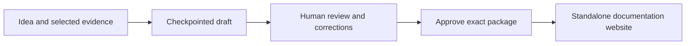
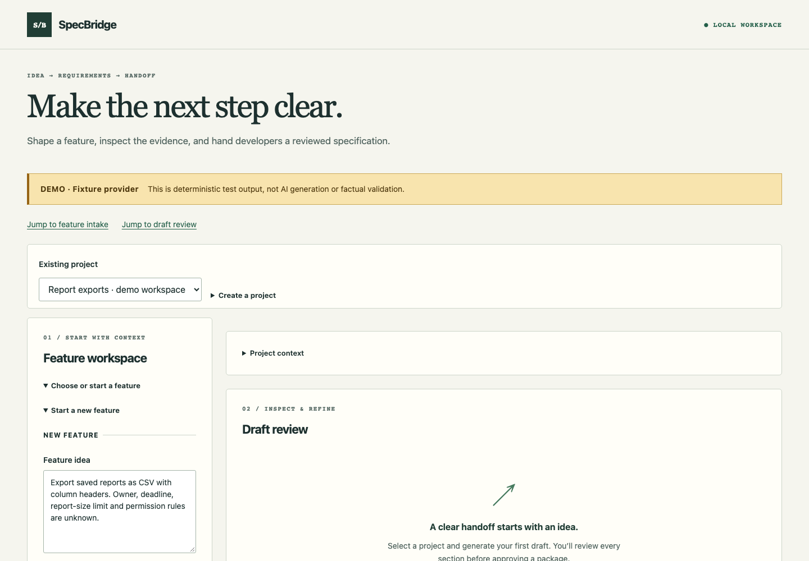
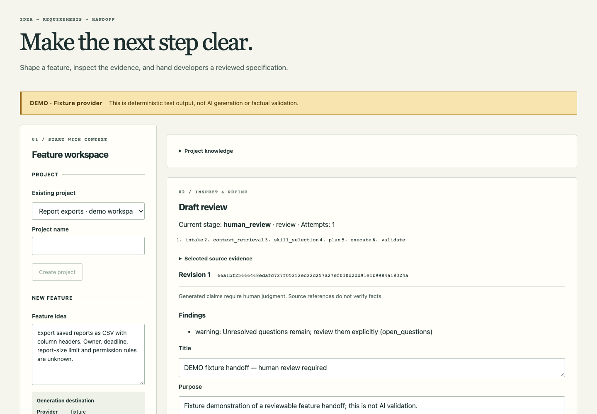
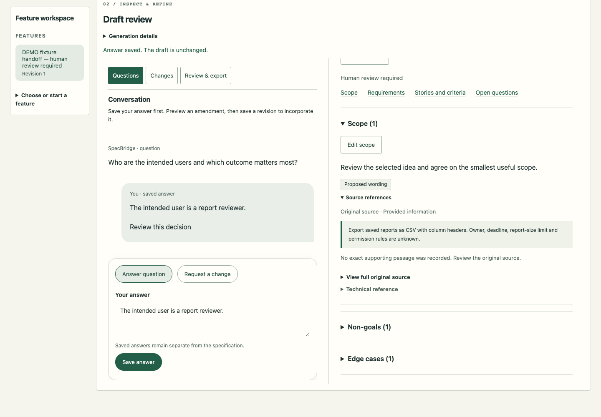
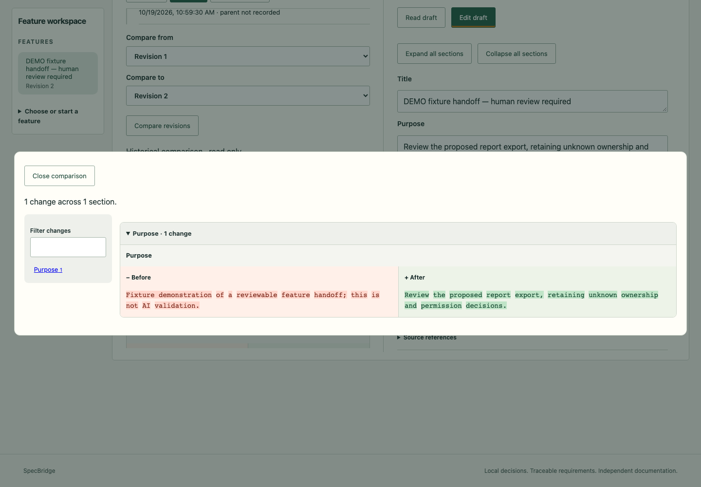
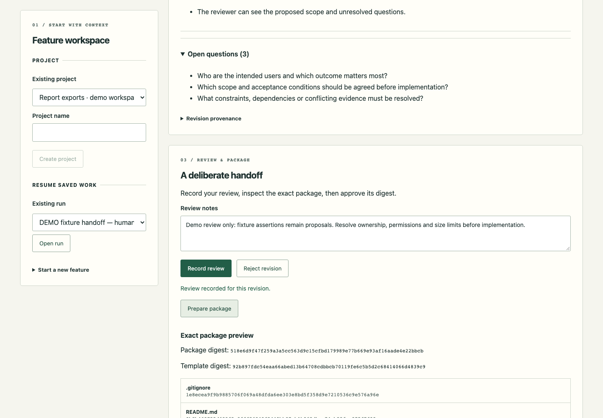
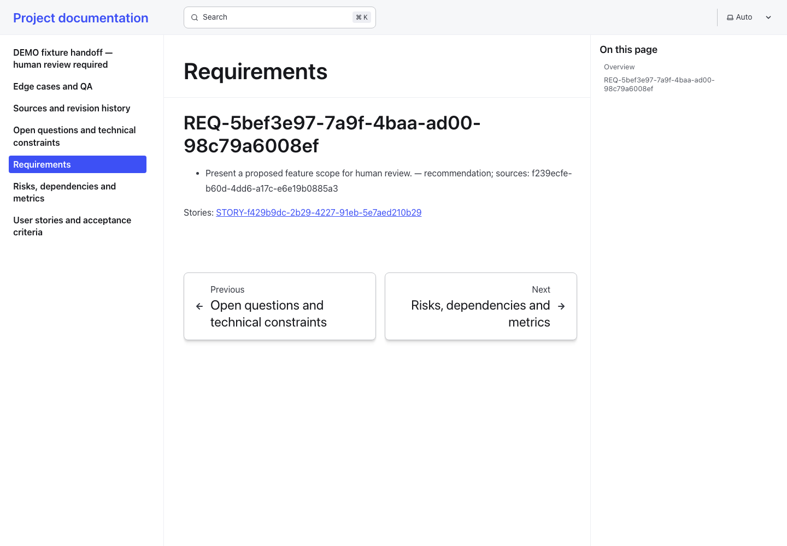
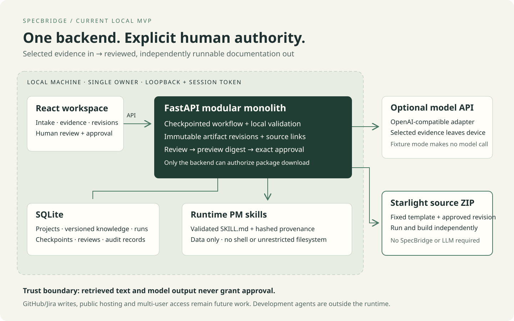

# SpecBridge

**From product ideas to reviewed engineering handoffs.**

SpecBridge turns feature ideas and selected project evidence into persisted PRDs, linked user stories, acceptance criteria, and documentation that developers can run independently. It keeps source references, unresolved questions, revision history, and human approval attached to the handoff.

The current release is a **local, single-owner MVP** with a React review workspace, a FastAPI/SQLite backend, and standalone Astro Starlight exports. Milestones 0 and 2 are delivered locally. Runtime integration of the qualified generation candidate and an unfamiliar-engineer handoff remain before full Milestone 1 acceptance. See the [phase status](docs/plans/roadmap-status-2026-10-16.md).

## Demo

[](docs/media/specbridge-demo.mp4)

[Watch or download the 30-second MP4](docs/media/specbridge-demo.mp4). Captured with Playwright and composed with Hyperframes using synthetic fixture data. This is a captioned walkthrough of the local MVP, not a live-model quality demonstration. For static views, see the screenshots below; [reproduction instructions](scripts/readme-media/README.md) include the editable video source.

## Workflow overview



## Contents

- [Demo](#demo)
- [Workflow overview](#workflow-overview)
- [Screenshots](#screenshots)
- [Architecture](#architecture)
- [Components](#components)
- [Install](#install)
- [Running the application](#running-the-application)
- [Create a handoff](#create-a-handoff)
- [Model providers](#model-providers)
- [Experiments and verification](#experiments-and-verification)
- [Data and external access](#data-and-external-access)
- [Results and resume](#results-and-resume)
- [Documentation](#documentation)
- [Contributing](#contributing)
- [License](#license)
- [Limitations](#limitations)

## Screenshots

### Start with an idea



### Inspect the draft



### Follow the original evidence



### Compare revisions



### Review the exact package



### Open the independent documentation



These are actual fixture captures. Product assertions remain proposals; demo approval is for this synthetic local package only.

## Architecture



The dashed box marks local application state. A configured hosted provider receives selected evidence; the exported website runs independently. GitHub/Jira writes and multi-user hosting remain future work. See the [architecture details](docs/architecture/first-slice.md).

## Components

One backend owns workflow transitions, persistence, validation, and approval. The frontend displays state and submits user intent.

| Component | Responsibility | Location |
| --- | --- | --- |
| Review workspace | Intake, source selection, corrections, review, and package download | `apps/web/` |
| Workflow and API | Checkpoints, artifacts, evidence labels, and approval enforcement | `services/api/specbridge/` |
| Project context | Versioned goals, stakeholders, decisions, risks, dependencies, API references, and notes | `services/api/specbridge/knowledge.py` |
| Runtime PM skills | Data-only instructions with validated metadata and hashed provenance | `skills/runtime/` |
| API contracts | Generated OpenAPI and frontend types | `packages/contracts/` |
| Documentation exporter | Fixed template, escaped content, manifests, and standalone source ZIP | `packages/docs-template/` |

See the [architecture](docs/architecture/first-slice.md) and [design decisions](docs/decisions/0001-local-modular-monolith.md) for boundaries and trade-offs.

## Install

Use **Python 3.12, Node.js 22.23.1, npm 10, and uv**. CI pins uv 0.12.17. From the repository root:

```sh
uv sync --locked
npm --prefix apps/web ci --ignore-scripts
```

## Running the application

SpecBridge runs as a local FastAPI backend accompanied by a React/Vite review workspace.

### 1. Start the API Backend

#### Option A: Deterministic Demo / Fixture Mode (No API keys required)
Run with the built-in synthetic fixture provider to explore workflows, UI interactions, and document packaging with zero configuration and zero API cost:

```sh
SPECBRIDGE_PROVIDER=fixture PYTHONPATH=services/api uv run python -m specbridge
```

#### Option B: Live LLM Provider (DeepSeek / OpenAI-compatible)
Copy `.env.example` to `.env`, set your model credentials and base URL (see [model providers guide](docs/engineering/model-providers.md)), then launch with the environment file:

```sh
uv run --env-file .env python -m specbridge
```

The API will listen at `http://127.0.0.1:8000` (health check: `http://127.0.0.1:8000/api/health`).

### 2. Start the Web UI

In a second terminal:

```sh
npm --prefix apps/web run dev
```

The React workspace will be available at **`http://127.0.0.1:5173`**.

### 3. Connect to your Workspace

1. Open `http://127.0.0.1:5173` in your browser.
2. Click **Auto-connect** to automatically exchange the local session bootstrap token (or copy the private token from `.data/session-token` into the **Session token** field and click **Connect**).
3. The session token is held solely in browser tab memory; it is never persisted to disk or external services.

> [!NOTE]
> For production builds or serving the static UI directly through FastAPI without running Vite separately, run `npm --prefix apps/web run build` and launch SpecBridge with `SPECBRIDGE_SERVE_STATIC=true`.

Existing workspaces require an additive schema upgrade before running this branch. See the [verified upgrade and rollback procedure](docs/engineering/focused-workspace-upgrade.md). The local owner workspace upgrade was separately authorized and verified; the procedure records backup and rollback details.

## Create a handoff

1. Select a project or choose **Create a project**. **Project context** is reusable background: save a note, then select **Use in next draft** to include that exact version. Saving background alone does not change a feature.
2. Open existing work, or enter a feature idea and choose **Review generation**. Confirm the displayed destination before generating.
3. Read the full draft beside the **Questions** conversation. Use **Answer question** or **Request a change** in the composer. **Save answer** records your decision separately. Choose a target and enter exact wording, then **Preview amendment** to see the proposed change. Source references quote original text; requirement/story links reveal and highlight the linked clause. Exact wording can be highlighted in the full source; when no precise passage was recorded, the UI says so. These actions make no model call.
4. Edit individual sections as needed. **Save working preview** preserves private work for reconnection; **Save revision** commits a new immutable revision and requires fresh review. Unpreviewed wording must be previewed or explicitly discarded first.
5. Use **Changes** for feature revision history, before/after comparison and requested changes. **Expand comparison** opens a section-indexed split diff with word highlights. A request becomes addressed only with an explicit saved revision.
6. In **Review & export**, record review, prepare and read the exact package, then approve it. Download and extract its ZIP into a new directory.

From the extracted directory:

```sh
npm ci
npm run dev
npm run build
npm run preview
```

The generated website runs without SpecBridge or an LLM API. Installation needs npm registry access. The package includes requirements, stories, acceptance criteria, edge cases, risks, questions, source references, revision metadata, and [Git collaboration instructions](packages/docs-template/README.md#local-git-changes).

Editing a revision invalidates its previous approval. Compare files before incorporating another export into developer-authored documentation; never extract over an existing repository silently.

## Model providers

| Mode | Current behavior |
| --- | --- |
| Fixture | Default, deterministic demonstration; no network or model call |
| OpenAI-compatible API | Explicit endpoint, model, and private credential; validates returned artifacts locally |
| Experimental typed-plan candidate | Evaluation-only generation plus deterministic assembly; not integrated into the application runtime |

The checked-in environment example targets DeepSeek. Follow the [setup guide](docs/engineering/model-providers.md) to create a private `.env`, select output mode and request limits, and load it explicitly. Native Claude support and local-model serving are not qualified; an OpenAI-compatible endpoint must be validated separately.

Hosted generation sends selected evidence to the configured provider and may incur charges. No model response can approve an artifact or authorize publication.

## Experiments and verification

The typed-plan candidate scored **5/5 on the same frozen semantic pack in two recorded live rounds**, with independent review and exact compilation replay. This is evidence for that candidate and pack, not general reliability or the quality of the application's current generator.

| Evidence | Report |
| --- | --- |
| Candidate design, initial failures, and first complete 5/5 round | [Compiled handoff evaluation](docs/evaluations/compiled-handoff.md) |
| Fresh paid repeat: 5/5 with the same configuration | [Post-audit live retest](docs/evaluations/post-audit-live-retest.md) |
| Codebase review and repairs: 317 backend tests, 19 browser checks, builds, recovery, and clean dependency audits | [Ponytail audit](docs/evaluations/ponytail-audit-2026-10-18.md) |

Run local checks:

```sh
python3 -m unittest discover -s tests -v
uv run pytest -q
npm --prefix apps/web run typecheck
npm --prefix apps/web run lint
npm --prefix apps/web test
npm --prefix apps/web run build
```

For browser and independent-package checks:

```sh
npm ci
PLAYWRIGHT_BROWSERS_PATH=.cache/playwright npm exec playwright install chromium
npm run test:e2e
uv run python scripts/verify_handoff.py --output /tmp/specbridge-handoff-check
```

Stop manual servers first; browser tests own ports 8000/5173 and use isolated fixture data. Choose a fresh output directory for every handoff check. That runner closes its SpecBridge fixture session before installing, building, and browsing the extracted site. See [engineering instructions](AGENTS.md) for static analysis, contract generation, and dependency-audit commands.

Paid evaluation uses a separate exact preview and bounded authorization. These local verification commands do not launch paid model tests.

## Data and external access

The application binds to loopback and uses a private local session token. Project data stays in `.data/specbridge.db`; protect that directory and its backups. Runtime PM skills have no shell or unrestricted filesystem access. Imported text is evidence, never authorization.

The provider rejects its configured credential in prompt payloads or generated artifacts. This is not general secret detection: keep credentials out of product evidence. The browser preview and exported content render untrusted text inertly.

GitHub/Jira writes and remote publication are not configured. Export approval authorizes the exact local package, not public hosting or an external write. Read the [security boundaries](docs/security/threat-model.md) before changing access or deployment behavior.

## Results and resume

Reopen a project after restarting the application to recover saved runs and revisions. Completed workflow stages remain checkpointed; a failed or interrupted provider stage requires explicit acknowledgment before a potentially billable retry.

Knowledge selection captures an exact version and evidence label. Later edits do not rewrite selected snapshots. Use the knowledge panel's continuation buttons to browse records, versions, and artifact revisions beyond the first 20.

Follow [workspace recovery](docs/engineering/workspace-recovery.md) for private backup and restore. Evaluation records live under `docs/evaluations/`; the [phase board](docs/engineering/specbridge-progress.html) is a maintained checkpoint, not background synchronization. If inline viewing is unavailable, the current session's offline browser export is `exports/specbridge-progress.html`; generated exports are ignored by Git.

## Documentation

| Guide | Use it for |
| --- | --- |
| [Architecture](docs/architecture/first-slice.md) | Module boundaries, workflow stages, and approval contracts |
| [Provider setup](docs/engineering/model-providers.md) | Credentials, output modes, token/wait settings, and local serving |
| [Workspace recovery](docs/engineering/workspace-recovery.md) | Knowledge, immutable snapshots, backup, and restore |
| [Documentation template](packages/docs-template/README.md) | Running and changing exported websites independently |
| [Roadmap](docs/plans/roadmap-status-2026-10-16.md) | Verified milestones and remaining acceptance work |
| [Skill inventory](docs/engineering/skill-inventory.md) | Development/runtime separation, sources, permissions, and licenses |
| [Planning conventions](docs/engineering/PLANS.md) | Resumable implementation plans and execution records |

## Contributing

Read [AGENTS.md](AGENTS.md), inspect the relevant source and callers, and use the existing locked dependencies. Substantial work needs a [self-contained plan](docs/engineering/PLANS.md), meaningful regressions, review, and updated documentation. Regenerate contracts after API changes and keep fixes reviewable. Do not commit credentials, overwrite authored files, or publish externally without authorization.

## License

Original SpecBridge code has **no distribution license selected**. Third-party dependencies and referenced projects retain their own licenses; those licenses do not license SpecBridge. Preserve upstream notices.

## Limitations

This is a local MVP. Native Claude/local-model qualification, hosted multi-user access, repository/PR publication, delivery automation, the full dashboard, and production deployment remain future work. Generated drafts need human review, and the unfamiliar-engineer acceptance scenario remains open. Codex is used for development; running SpecBridge does not require it.
